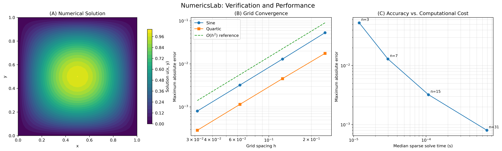
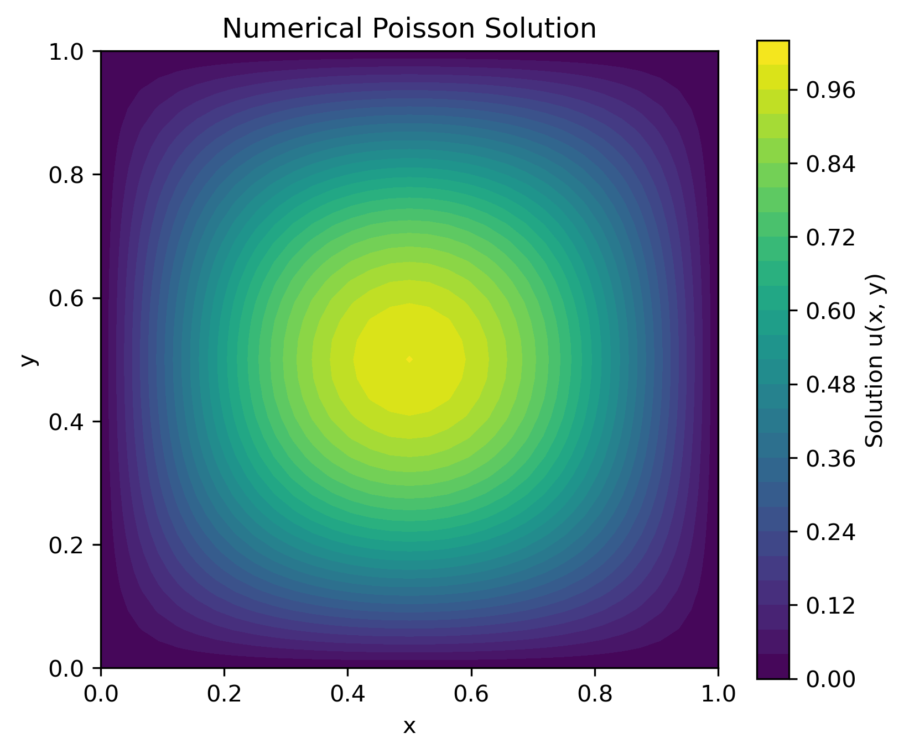
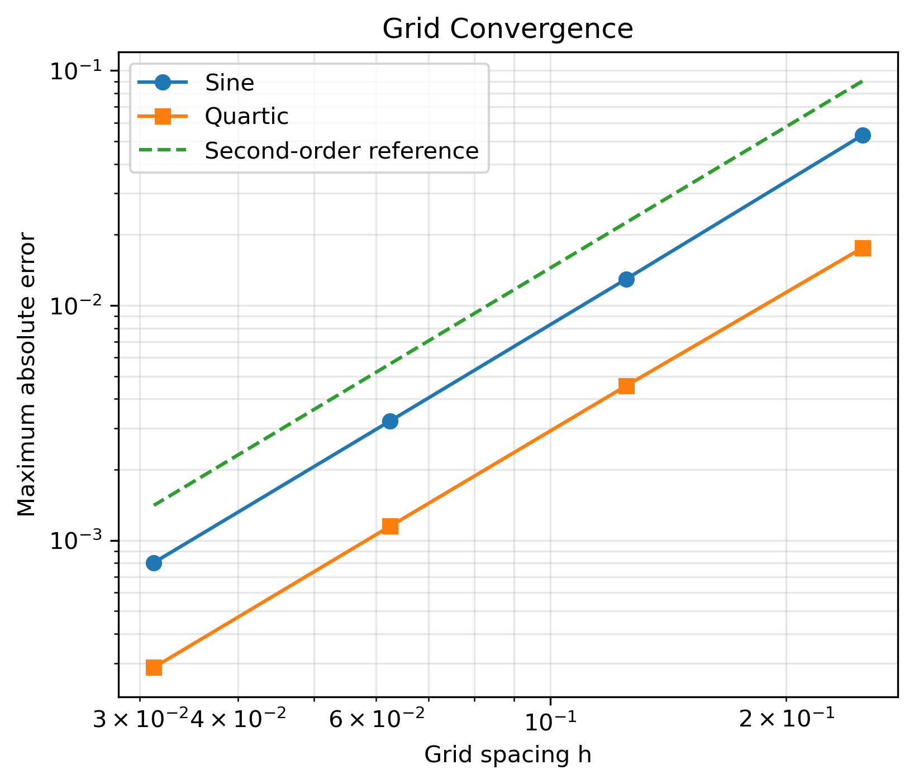
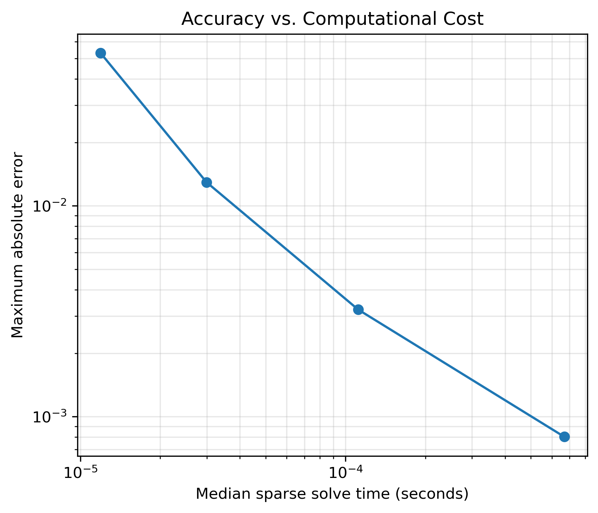

# NumericsLab

**A Verified 2D Poisson Solver with Automated Convergence and Performance Analysis**

NumericsLab is a scientific Python project demonstrating finite-difference discretization, sparse linear algebra, numerical verification, performance benchmarking, and reproducible computational experiments.

The project focuses on implementing and verifying a numerical PDE solver, with an emphasis on mathematical correctness, transparent testing, and scientific software engineering.

📄 [Read the Technical Report](TECHNICAL_REPORT.md)



## 1. Mathematical Problem

NumericsLab solves the two-dimensional Poisson equation:

$$
-\nabla^2 u(x,y) = f(x,y)
$$

on the unit square:

$$
\Omega = [0,1]^2
$$

subject to prescribed Dirichlet boundary conditions:

$$
u(x,y) = g(x,y), \qquad (x,y)\in\partial\Omega.
$$

Here:

- $u(x,y)$ is the unknown scalar field.
- $f(x,y)$ is a prescribed source function.
- $g(x,y)$ defines the boundary values.
- $\partial\Omega$ denotes the boundary of the computational domain.

The solver accepts user-defined source and boundary functions, allowing different manufactured solutions to be tested without modifying the numerical algorithm.

## 2. Numerical Method

### Finite-Difference Discretization

The Laplacian is approximated using the standard five-point, second-order finite-difference stencil on a uniform Cartesian grid.

At an interior grid point $(i,j)$:

$$
-\nabla^2u_{i,j}\approx
\frac{
4u_{i,j}
-u_{i-1,j}
-u_{i+1,j}
-u_{i,j-1}
-u_{i,j+1}
}{h^2}.
$$

The grid spacing is:

$$
h=\frac{1}{n+1}
$$

where $n$ is the number of interior grid points in each coordinate direction.

The discretization produces a sparse linear system:

$$
A\mathbf{u}=\mathbf{b}.
$$

### Implementation Details

- **Domain:** Two-dimensional unit square
- **Grid:** Uniform Cartesian grid
- **Unknowns:** $n^2$ interior values
- **Discretization:** Five-point finite differences
- **Expected accuracy:** Second-order in grid spacing
- **Sparse assembly:** SciPy LIL matrix
- **Matrix storage for solution:** CSR format
- **Linear solver:** `scipy.sparse.linalg.spsolve`
- **Boundary conditions:** Prescribed Dirichlet values incorporated into the right-hand side

The primary solver interface is:

`solve_poisson(n, source_fn, boundary_fn)`

The solver returns the interior solution vector. A separate reconstruction function generates the full two-dimensional field, including boundary values.

## 3. Numerical Verification

Numerical correctness is evaluated using the **method of manufactured solutions**.

For each verification case, an analytical function $u_{\mathrm{exact}}(x,y)$ is prescribed. Its corresponding source term is calculated from the governing equation, and the numerical result is compared against the analytical solution.

### Manufactured Solutions

| Case | Exact solution | Source term | Verification purpose |
|---|---|---|---|
| Sine | $\sin(\pi x)\sin(\pi y)$ | $2\pi^2\sin(\pi x)\sin(\pi y)$ | Second-order convergence with zero Dirichlet boundaries |
| Quadratic | $x^2+y^2$ | $-4$ | Exact stencil reproduction with nonzero Dirichlet boundaries |
| Quartic | $x^4+y^4$ | $-12(x^2+y^2)$ | Second-order convergence with nonzero Dirichlet boundaries |

The maximum absolute error is evaluated over the interior grid points:

$$
E_\infty = \max_i \left|u_i^{\mathrm{numerical}} - u_i^{\mathrm{exact}}\right|.
$$

### Convergence Results

| Interior grid size $n$ | Grid spacing $h$ | Sine maximum error | Quartic maximum error |
|---|---|---|---|
| 3 | 0.25000 | 5.30293e-2 | 1.75781e-2 |
| 7 | 0.12500 | 1.29507e-2 | 4.54891e-3 |
| 15 | 0.06250 | 3.21896e-3 | 1.14759e-3 |
| 31 | 0.03125 | 8.03578e-4 | 2.87558e-4 |

### Observed Convergence Orders

For successive grid refinements, the observed convergence order is:

$$
p = \frac{\ln(E_{\mathrm{coarse}}/E_{\mathrm{fine}})}
{\ln(h_{\mathrm{coarse}}/h_{\mathrm{fine}})}.
$$

When the grid spacing is halved, this simplifies to:

$$
p = \log_2(E_{\mathrm{coarse}}/E_{\mathrm{fine}}).
$$

| Grid refinement | Sine order | Quartic order |
|---|---:|---:|
| 3 → 7 | 2.034 | 1.950 |
| 7 → 15 | 2.008 | 1.987 |
| 15 → 31 | 2.002 | 1.997 |

Both manufactured solutions approach the theoretical second-order convergence rate:

$$
E_\infty = O(h^2).
$$

The quadratic manufactured solution is reproduced to approximately floating-point precision. This occurs because the five-point stencil reproduces the Laplacian of the quadratic function exactly, apart from floating-point effects.

Consequently, the quadratic case is used to verify implementation correctness rather than to estimate convergence order.

The sine and quartic cases provide independent convergence evidence for zero and nonzero Dirichlet boundary conditions, respectively.

## 4. Performance Benchmark

NumericsLab measures the execution time of SciPy sparse linear-system solves at different grid resolutions.

### Benchmark Procedure

For each grid size:

1. Assemble the sparse matrix and right-hand-side vector.
2. Perform one untimed warm-up solve.
3. Execute 20 timed sparse solves.
4. Measure each solve using `time.perf_counter()`.
5. Report the median execution time.

**Each timed `spsolve(A, b)` call includes sparse factorization and solution.**

Matrix assembly, right-hand-side construction, solution reconstruction, and visualization are excluded from the timing measurements.

The resulting error-versus-runtime figure illustrates the tradeoff between numerical accuracy and computational cost for the tested grid sizes.

Runtime measurements depend on hardware, software versions, and system conditions. They are intended for comparative demonstration rather than universal solver-performance predictions.

## 5. Scientific Visualizations

NumericsLab generates three primary figure types.

### Numerical Solution Heatmap



The solution heatmap visualizes the numerical approximation for the sine manufactured solution on the unit square.

### Grid Convergence



The log-log convergence plot compares sine and quartic errors against grid spacing and includes a second-order reference slope.

### Accuracy vs. Computational Cost



The performance figure compares maximum numerical error with the median sparse solve time.

A combined three-panel overview is also generated for concise scientific presentation.

## 6. Installation and Reproduction

### Requirements

- Python 3.12 or a compatible version
- NumPy
- SciPy
- Matplotlib
- pytest

### Installation

Clone the repository:

```bash
git clone https://github.com/BatyaOG/NumericsLab.git
cd NumericsLab
```

Install the dependencies:

```bash
python -m pip install -r requirements.txt
```

### Run All Experiments

Execute the complete numerical workflow:

```bash
python -m numericslab.run_all
```

This command performs the manufactured-solution verification experiments, checks the quadratic case, executes the solve-time benchmark, and generates the scientific figures.

Generated outputs:

- `figures/solution_heatmap.png`
- `figures/convergence.png`
- `figures/error_vs_runtime.png`
- `figures/overview.png`

### Run Automated Tests

Execute the test suite from the repository root:

```bash
python -m pytest tests/test_solver.py -q
```

## 7. Software Architecture and Quality

The implementation separates the numerical solver, mathematical verification cases, scientific experiments, and visualization into reusable Python modules.

### Project Structure

```text
NumericsLab/
├── numericslab/
│   ├── __init__.py
│   ├── solver.py
│   ├── cases.py
│   ├── experiments.py
│   ├── plotting.py
│   └── run_all.py
├── tests/
│   └── test_solver.py
├── figures/
│   ├── solution_heatmap.png
│   ├── convergence.png
│   ├── error_vs_runtime.png
│   └── overview.png
├── .github/
│   └── workflows/
│       └── tests.yml
├── requirements.txt
├── .gitignore
└── README.md
```

### Automated Testing

Eight pytest tests cover:

1. Grid-index mapping
2. Sparse matrix structure and symmetry
3. Right-hand-side construction with nonzero boundary contributions
4. Quadratic manufactured-solution accuracy
5. Second-order convergence for sine and quartic solutions
6. Full two-dimensional solution reconstruction
7. General convergence order for arbitrary refinement ratios
8. Asymmetric manufactured-solution regression

GitHub Actions is configured to execute the numerical tests automatically on pushes and pull requests.

The automated tests complement the manufactured-solution verification experiments. Passing tests provides evidence that the implementation satisfies the tested requirements, but does not constitute proof of correctness for every possible input.

## 8. Physical Interpretation and Limitations

### Connection to Darcy Flow

For steady, incompressible single-phase flow in a homogeneous, isotropic porous medium, Darcy's law is:

$$
\mathbf{v} = -\frac{k}{\mu}\nabla P
$$

where:

- $\mathbf{v}$ is the Darcy velocity.
- $k$ is permeability.
- $\mu$ is dynamic viscosity.
- $P$ is pressure.

Combining Darcy's law with steady mass conservation gives, under the corresponding source-term convention:

$$
-\nabla\cdot
\left(
\frac{k}{\mu}\nabla P
\right)
=q.
$$

When permeability and viscosity are constant, this reduces to:

$$
-\nabla^2P=\frac{\mu}{k}q.
$$

This equation has the same mathematical form as the Poisson equation solved by NumericsLab.

However, **NumericsLab is a numerical Poisson solver, not a reservoir simulator**. Its verification problems use analytical manufactured solutions rather than calibrated physical reservoir models.

### Current Limitations

- Two-dimensional uniform Cartesian grids only
- Constant-coefficient Laplacian
- Prescribed Dirichlet boundary conditions
- Sparse direct linear solution
- No time-dependent physics
- No spatially variable permeability or other variable coefficients
- No physical well model or reservoir-specific source treatment
- Small demonstration grids rather than large-scale performance studies

Possible future extensions include variable-coefficient operators and alternative linear solvers. Such extensions would require additional implementation, numerical verification, and performance analysis.

## 9. Reproducibility

NumericsLab provides a single-command workflow for reproducing its numerical verification experiments and scientific figures.

The repository includes the source code, verification cases, automated tests, dependency specifications, and GitHub Actions workflow.

The convergence experiments use deterministic manufactured solutions. Benchmark timings may differ across execution environments.

The project is intended as a transparent educational and scientific-software demonstration of verified finite-difference numerical methods.

---

**NumericsLab — Verified numerical methods, reproducible experiments, and transparent scientific computing.**